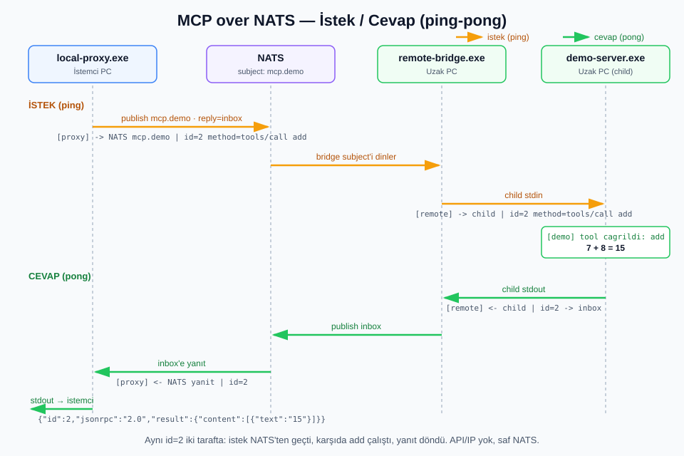

# Demo — two terminals, flow with screenshots

Goal: show **live in two terminals** that an MCP request travels from this PC over NATS to the remote PC, runs there as a tool, and the response comes back. Logs are on stderr; `local-proxy`'s stdout stays pure JSON-RPC (MCP is not broken).

## 0) Preparation

- For the **local demo**, NATS must run on this PC: `bin\nats-server-v2.15.3-windows-amd64\nats-server.exe -p 4222`. Not needed for the **cloud demo**.
- Copy the **new logged binaries** to the VM (overwrite): `target\release\remote-bridge.exe` + `target\release\demo-server.exe` → VM Desktop. Stop the old bridge on the VM and start the new one.
- `local-proxy.exe` on this PC is already the new build.

## 1) Terminal B — remote/VM (server side)

```powershell
# local demo (<HOST_IP> = LAN IP of the PC running NATS):
$env:NATS_URL="nats://<HOST_IP>:4222"; .\remote-bridge.exe
# cloud demo:
$env:NATS_URL="tls://connect.ngs.global:4222"; $env:NATS_CREDS="C:\yol\synadia.creds"; .\remote-bridge.exe
```

Startup line: `[remote] NATS: ... | subject: mcp.demo | server: ...`

## 2) Terminal A — this PC (client side)

```powershell
# local demo:
$env:NATS_URL="nats://localhost:4222"; .\local-proxy.exe
# cloud demo:
$env:NATS_URL="tls://connect.ngs.global:4222"; $env:NATS_CREDS="C:\yol\synadia.creds"; .\local-proxy.exe
```

The cursor waits on stdin. Paste these two lines:

```
{"jsonrpc":"2.0","id":1,"method":"initialize","params":{"protocolVersion":"2025-06-18","capabilities":{},"clientInfo":{"name":"demo","version":"0.1.0"}}}
{"jsonrpc":"2.0","id":2,"method":"tools/call","params":{"name":"add","arguments":{"a":7,"b":8}}}
```

## 3) The screenshot story



**Terminal A (client):**
```
[proxy] -> NATS mcp.demo | id=2 method=tools/call add
{"id":2,"jsonrpc":"2.0","result":{"content":[{"text":"15","type":"text"}]}}
[proxy] <- NATS yanit | id=2
```

**Terminal B (server):**
```
[remote] -> child | id=2 method=tools/call add
[demo] tool cagrildi: add
[remote] <- child | id=2 -> inbox
```

The same `id=2` appears in both terminals: the request crossed NATS, `add` ran on the other side, and the response came back. Put the two terminals **side by side** and take a screenshot; mark the `-> NATS` / `-> child` / `<- child` / `<- NATS` order with arrows.

Real capture (top: VM `remote-bridge`, bottom: this PC `local-proxy`):


## 4) Alternative with an MCP client

While the VM bridge runs, open a new chat in an MCP-capable client: "add 7+8 with nats-demo". Show the client's answer together with the VM terminal's `[demo] tool cagrildi: add` line — it proves the AI's call really ran on the remote PC.

## Notes

- Only **one** `remote-bridge` should listen on the same NATS + same subject; keep other bridges closed during the demo.
- In the cloud demo both sides use the Synadia URL + creds; no local `nats-server` is needed.
- If you call `get_time`, the remote PC's clock is returned — a good second example to show the difference between the two PCs.