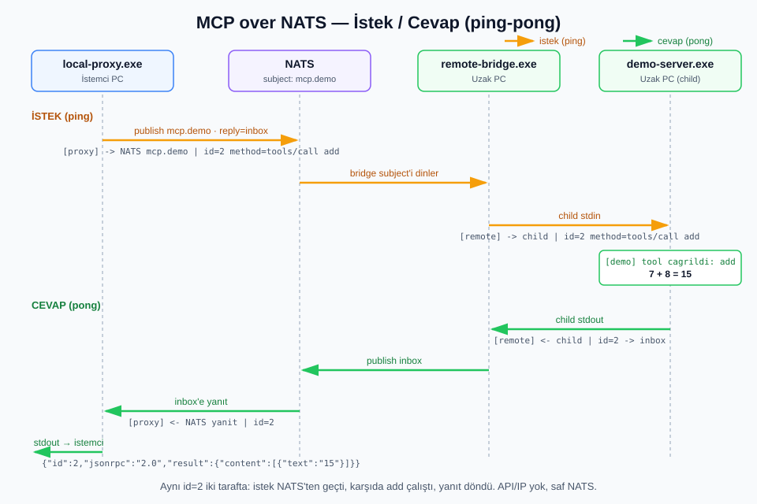

# Demo — iki terminal, ekran görüntüsüyle akış

Amaç: bir MCP isteğinin bu PC'den NATS üzerinden uzak PC'ye gidip orada tool olarak çalıştığını ve yanıtın geri döndüğünü **iki terminalde canlı** göstermek. Log'lar stderr'dedir; `local-proxy`'nin stdout'u saf JSON-RPC kalır (MCP bozulmaz).

## 0) Hazırlık

- **Yerel demo** için bu PC'de NATS çalışmalı: `bin\nats-server-v2.15.3-windows-amd64\nats-server.exe -p 4222`. **Cloud demo** için gerekmez.
- VM'e **log'lu yeni binary'leri** kopyala (üzerine yaz): `target\release\remote-bridge.exe` + `target\release\demo-server.exe` → VM Desktop. VM'deki eski bridge'i durdurup yenisini başlat.
- Bu PC'deki `local-proxy.exe` zaten yeni sürüm.

## 1) Terminal B — uzak/VM (sunucu tarafı)

```powershell
# yerel demo (<HOST_IP> = NATS'ın çalıştığı PC'nin LAN IP'si):
$env:NATS_URL="nats://<HOST_IP>:4222"; .\remote-bridge.exe
# cloud demo:
$env:NATS_URL="tls://connect.ngs.global:4222"; $env:NATS_CREDS="C:\yol\synadia.creds"; .\remote-bridge.exe
```

Başlangıç satırı: `[remote] NATS: ... | subject: mcp.demo | server: ...`

## 2) Terminal A — bu PC (istemci tarafı)

```powershell
# yerel demo:
$env:NATS_URL="nats://localhost:4222"; .\local-proxy.exe
# cloud demo:
$env:NATS_URL="tls://connect.ngs.global:4222"; $env:NATS_CREDS="C:\yol\synadia.creds"; .\local-proxy.exe
```

İmleç stdin'de bekler. Şu iki satırı yapıştır:

```
{"jsonrpc":"2.0","id":1,"method":"initialize","params":{"protocolVersion":"2025-06-18","capabilities":{},"clientInfo":{"name":"demo","version":"0.1.0"}}}
{"jsonrpc":"2.0","id":2,"method":"tools/call","params":{"name":"add","arguments":{"a":7,"b":8}}}
```

## 3) Ekran görüntüsü hikâyesi



**Terminal A (istemci):**
```
[proxy] -> NATS mcp.demo | id=2 method=tools/call add
{"id":2,"jsonrpc":"2.0","result":{"content":[{"text":"15","type":"text"}]}}
[proxy] <- NATS yanit | id=2
```

**Terminal B (sunucu):**
```
[remote] -> child | id=2 method=tools/call add
[demo] tool cagrildi: add
[remote] <- child | id=2 -> inbox
```

Aynı `id=2` iki terminalde de görünür: istek NATS'ten geçti, karşıda `add` çalıştı, yanıt döndü. İki terminali **yan yana** koyup ekran görüntüsü al; oklarla `-> NATS` / `-> child` / `<- child` / `<- NATS` sırasını işaretle.

Gerçek yakalama (üst: VM `remote-bridge`, alt: bu PC `local-proxy`):


## 4) MCP istemcisi ile alternatif

VM bridge çalışırken MCP destekli istemcide yeni sohbet aç: "nats-demo ile 7+8'i topla". İstemcinin cevabını ve VM terminalindeki `[demo] tool cagrildi: add` satırını birlikte görüntüle — AI'ın çağrısının gerçekten uzak PC'de çalıştığını gösterir.

## Notlar

- Aynı NATS + aynı subject'te **tek** `remote-bridge` dinlemeli; demo sırasında başka bridge açık olmasın.
- Cloud demo'da iki taraf da Synadia URL + creds kullanır; yerel `nats-server` gerekmez.
- `get_time` çağırırsan uzak PC'nin saati döner — iki PC farkını göstermek için iyi bir ikinci örnek.