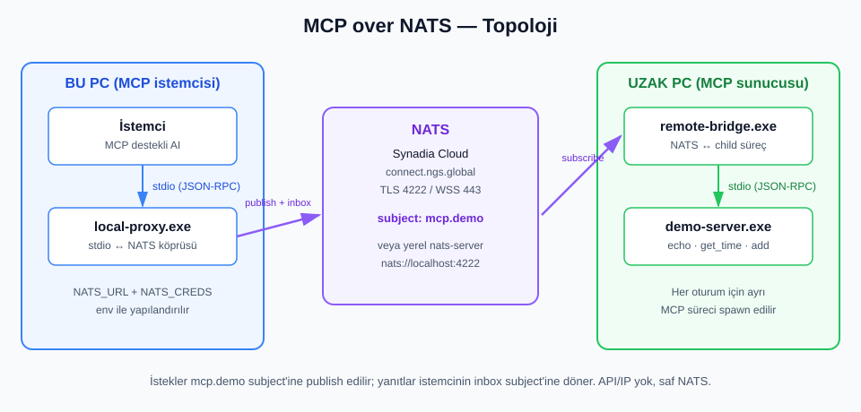
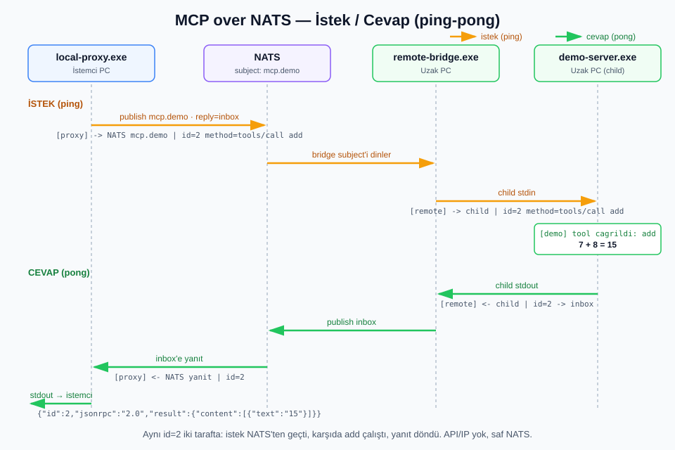
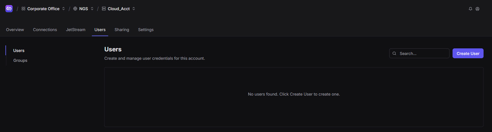
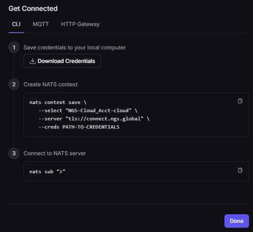
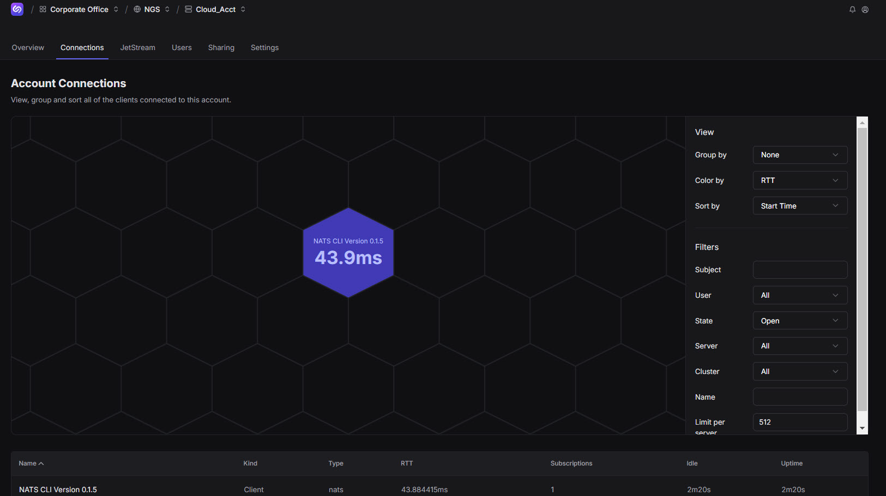

# McpOverNatsSample

<a href="README.md"> <strong>English</strong></a> &nbsp;·&nbsp; <a href="README.tr.md"> Türkçe</a>

The most basic example setup that connects an MCP-capable client to an MCP server on a remote PC **over NATS**. No API and no direct IP connection; all MCP traffic (JSON-RPC) travels over NATS subjects. The broker can be a local `nats-server` or **Synadia Cloud**.

Written in Rust (`async-nats` + `tokio`). Three small binaries:

- `local-proxy.exe` — **Client PC:** stdio ↔ NATS bridge. The MCP client starts this as if it were an MCP server.
- `remote-bridge.exe` — **Server PC (remote):** listens on the NATS subject and spawns one MCP server process per session.
- `demo-server.exe` — **Server PC (remote):** example MCP server: `echo`, `get_time`, `add`.

Live two-terminal demo (flow with screenshots): [DEMO.en.md](DEMO.en.md)

## Topology



```
Client ──stdio──> local-proxy ──NATS──> remote-bridge ──stdio──> demo-server
 (client PC)                 (subject: mcp.demo)              (server PC)
```

## How it works

1. The client starts `local-proxy` over stdio and writes MCP JSON-RPC lines to its stdin.
2. `local-proxy` publishes each line to the `mcp.demo` subject with its own inbox as the reply-to.
3. `remote-bridge` listens on the subject; per reply-to (inbox) it spawns a `demo-server` child process and writes the line to the child's stdin.
4. The child's stdout lines are published back to the inbox subject; `local-proxy` writes them to stdout → the client receives the response.

A single NATS subject plus one inbox per client is enough. Requests/responses and notifications flow over the same line.



## Requirements

- Rust (cargo) — to build. Only the compiled `.exe` files need to be copied to the remote PC; Rust is not required there.
- For the local demo: NATS Server v2.15.3 for Windows x64 is bundled under `bin/`. [Source and verified checksums](bin/README.md). On Linux/macOS, use the corresponding upstream build.
- For Synadia Cloud: an account and a `.creds` file (see below).

## Build

```bash
cargo build --locked --release
# binaries: target/release/{local-proxy,remote-bridge,demo-server}.exe
```

The three binary sources are in `src/bin/`. On Linux/macOS, the compiled files
have the same names without `.exe`.

This is a free example for exploring the transport design and adapting it to your
own projects.

## Environment variables

- `NATS_URL` (default: `nats://localhost:4222`) — NATS address. Synadia: `tls://connect.ngs.global:4222` or `wss://connect.ngs.global:443`
- `NATS_CREDS` (default: none) — full path to the `.creds` file. Not needed for the local demo.
- `MCP_SUBJECT` (default: `mcp.demo`) — the subject the bridge listens on / publishes to.
- `MCP_SERVER_BIN` (default: sibling `demo-server.exe`) — the MCP server that remote-bridge spawns.

---

## MCP client configurations (two separate entries)

Both servers can stay defined at the same time because they connect to **different NATS networks** (local/VM vs Synadia Cloud). The single-bridge rule applies per network: only one `remote-bridge` should listen on the same NATS + same subject.

Shareable ready-made file: [`mcp.example.json`](mcp.example.json) (the creds path is a placeholder; edit it for yourself).

### 1) `nats-demo` — local / VM (demo-server)

`nats-server` runs on this PC; `remote-bridge` + `demo-server` run on the remote/VM. No secret needed.

```json
{
  "mcpServers": {
    "nats-demo": {
      "command": "<PROJE>/target/release/local-proxy.exe",
      "args": [],
      "env": { "NATS_URL": "nats://localhost:4222", "MCP_SUBJECT": "mcp.demo" }
    }
  }
}
```

### 2) `nats-cloud` — Synadia Cloud

`NATS_CREDS` points to the real `.creds` file (never committed). A `remote-bridge` connected to the cloud must be running on the other side.

```json
{
  "mcpServers": {
    "nats-cloud": {
      "command": "<PROJE>/target/release/local-proxy.exe",
      "args": [],
      "env": {
        "NATS_URL": "tls://connect.ngs.global:4222",
        "NATS_CREDS": "C:\\path\\to\\synadia.creds",
        "MCP_SUBJECT": "mcp.demo"
      }
    }
  }
}
```

---

## MCP clients (Qoder, Kiro, Antigravity, Codex, …)

`local-proxy` is a standard **stdio MCP server**; it works with any MCP-capable client. Replace `<PROJE>` with this repository's path and `<CREDS>` with the creds file path. Most clients use the same `mcpServers` JSON; only the file location and a couple of formats differ.

Common stdio configuration (`mcpServers` format):

```json
{
  "mcpServers": {
    "nats-demo": {
      "command": "<PROJE>/target/release/local-proxy.exe",
      "args": [],
      "env": { "NATS_URL": "nats://localhost:4222", "MCP_SUBJECT": "mcp.demo" }
    }
  }
}
```

- **Qoder** — Settings > MCP (user) or project · format: `mcpServers`
- **Kiro** — workspace `.kiro/settings/mcp.json` · user `~/.kiro/settings/mcp.json` · format: `mcpServers`
- **Antigravity** — `~/.gemini/config/mcp_config.json` (IDE + CLI shared) · format: `mcpServers`
- **Claude Desktop** — Win `%APPDATA%\Claude\claude_desktop_config.json` · mac `~/Library/Application Support/Claude/claude_desktop_config.json` · format: `mcpServers`
- **Claude Code** — project `.mcp.json` · `claude mcp add` · format: `mcpServers`
- **Cursor** — project `.cursor/mcp.json` · user `~/.cursor/mcp.json` · format: `mcpServers`
- **Windsurf** — `~/.codeium/windsurf/mcp_config.json` · format: `mcpServers`
- **Cline** — VS Code `cline_mcp_settings.json` · format: `mcpServers`
- **Gemini CLI** — `~/.gemini/settings.json` · format: `mcpServers`
- **VS Code (Copilot)** — project `.vscode/mcp.json` · format: `servers` + `type:"stdio"`
- **Codex CLI** — `~/.codex/config.toml` · format: TOML `[mcp_servers.*]`

VS Code format:

```json
{
  "servers": {
    "nats-demo": {
      "type": "stdio",
      "command": "<PROJE>/target/release/local-proxy.exe",
      "args": [],
      "env": { "NATS_URL": "nats://localhost:4222", "MCP_SUBJECT": "mcp.demo" }
    }
  }
}
```

Codex CLI format (TOML):

```toml
[mcp_servers.nats-demo]
command = "<PROJE>/target/release/local-proxy.exe"
args = []

[mcp_servers.nats-demo.env]
NATS_URL = "nats://localhost:4222"
MCP_SUBJECT = "mcp.demo"
```

For the cloud, add `NATS_URL="tls://connect.ngs.global:4222"` + `NATS_CREDS="<CREDS>/synadia.creds"` to `env` (see the two-entry section above).

---

## Scenario A — Local demo (no secret needed)

```bash
# 1) NATS server
bin/nats-server-v2.15.3-windows-amd64/nats-server.exe -a 127.0.0.1 -p 4222

# 2) Bridge (separate terminal)
target/release/remote-bridge.exe
```

Client MCP setting (stdio):

```json
{
  "mcpServers": {
    "nats-demo": {
      "command": "<PROJE>/target/release/local-proxy.exe",
      "args": [],
      "env": { "NATS_URL": "nats://localhost:4222", "MCP_SUBJECT": "mcp.demo" }
    }
  }
}
```

## Scenario B — Synadia Cloud

### 1) Download credentials

In the Synadia Cloud UI, create a user (or select an existing one) under the **Users** tab of your account:



Open the **Get Connected** dialog for the user. On the **CLI** tab:
1. Use **Download Credentials** to download the `.creds` file.
2. The server address appears as `tls://connect.ngs.global`.



> **Note:** The **HTTP Gateway** tab in the same dialog produces a *Bearer token* for the REST API. That token **cannot** be used for a NATS client connection. What NATS needs is the `.creds` file (JWT + nkey seed) from the CLI tab.

### 2) Keep the file outside the project

Do **not** put the real `.creds` file in the repo. E.g. `secrets/synadia.creds` (gitignored) or a path outside the project. For the format see [`synadia.creds.sample`](synadia.creds.sample).

### 3) Connect the bridge to the cloud

```bash
NATS_URL="tls://connect.ngs.global:4222" \
NATS_CREDS="C:\\yol\\synadia.creds" \
target/release/remote-bridge.exe
```

Client MCP setting:

```json
{
  "mcpServers": {
    "nats-demo": {
      "command": "<PROJE>/target/release/local-proxy.exe",
      "args": [],
      "env": {
        "NATS_URL": "tls://connect.ngs.global:4222",
        "NATS_CREDS": "C:\\yol\\synadia.creds",
        "MCP_SUBJECT": "mcp.demo"
      }
    }
  }
}
```

You can watch the connection live from the Synadia UI **Connections** tab:



## Scenario C — Remote PC

Copy just two files to the remote PC: `remote-bridge.exe` + `demo-server.exe` (same folder). Rust is not required.

```powershell
$env:NATS_URL="tls://connect.ngs.global:4222"
$env:NATS_CREDS="C:\yol\synadia.creds"
.\remote-bridge.exe
```

The client PC's MCP setting stays the same as Scenario B. Now the tools run **on the remote PC** (`get_time` returns the remote PC's clock).

> **Important:** Only **one** `remote-bridge` should listen on the same `MCP_SUBJECT` on the same NATS. If two bridges listen on the same subject, every request gets two responses. When you bring the remote PC online, stop the cloud bridge on this PC.

---

## Verification

Test the chain by feeding JSON-RPC to `local-proxy` by hand:

```bash
(printf '%s\n' \
 '{"jsonrpc":"2.0","id":1,"method":"initialize","params":{"protocolVersion":"2025-06-18","capabilities":{},"clientInfo":{"name":"test","version":"0.1.0"}}}' \
 '{"jsonrpc":"2.0","id":2,"method":"tools/call","params":{"name":"add","arguments":{"a":7,"b":8}}}'; sleep 2) \
 | target/release/local-proxy.exe
```

Expected: an `initialize` response and `"text":"15"` for `add`. For Synadia, add the `NATS_URL`/`NATS_CREDS` env vars to the same command.

## Security

- The real `.creds` never enters the repo: `.gitignore` excludes `*.creds`, `/secrets/`, `/target/` and local session transcripts. The bundled broker contains no credentials or local configuration.
- Only the placeholder [`synadia.creds.sample`](synadia.creds.sample) is in the repo.
- A `.creds` file contains a JWT + nkey seed; treat it like a password, do not share it.

- The local command binds to loopback. For a LAN demo, explicitly choose the broker's LAN address and configure authentication, subject permissions and firewall access before connecting another PC.

## Example limits

This sample keeps one child MCP server per client inbox until the bridge stops;
it has no idle-session cleanup. Keep the proxy's stdin open while waiting for
responses. NATS Core does not store traffic for disconnected clients. These are
limits of this small example.

## Troubleshooting

- **Remote PC cannot connect (LAN):** Windows Firewall may be blocking inbound 4222.
- **Synadia `authorization violation`:** the creds user's subject permissions do not cover `mcp.demo`; widen the permissions in the Synadia UI or set `MCP_SUBJECT` to an allowed subject.
- **`Access denied (os error 5)` during build:** a running `.exe` cannot be overwritten; stop the relevant bridge process first, then `cargo build`.
- **No response:** make sure the bridge is running and using the correct `NATS_URL`/`MCP_SUBJECT`; look for the `session başladı` line on the bridge's stderr.

## Disclaimer

This repository is a **minimal, educational example**, provided **as is, without warranty of any kind**. It is not hardened for production use.

Sharing connection details, subject names and especially `.creds` files can be **dangerous**: anyone who obtains them can publish/subscribe on your broker and reach the MCP server that the bridge spawns. Keep credentials secret, scope NATS subject permissions narrowly, never expose the broker or the bridge to the public internet, and run the demo only on networks you trust.

You use this example **at your own risk**; the authors accept no liability for any damage, data loss or security incident arising from it.

## Resources

- NATS (official): [nats.io](https://nats.io) · server source: [github.com/nats-io/nats-server](https://github.com/nats-io/nats-server)
- Synadia Cloud: [cloud.synadia.com](https://cloud.synadia.com) · documentation: [docs.synadia.com](https://docs.synadia.com)

## Related work

- [ExtViaNats](https://github.com/cihadkocasahan/ext-via-nats) — another NATS/MCP example, applying the transport to a Chrome extension.
- [More projects and technical profile](https://github.com/cihadkocasahan)
