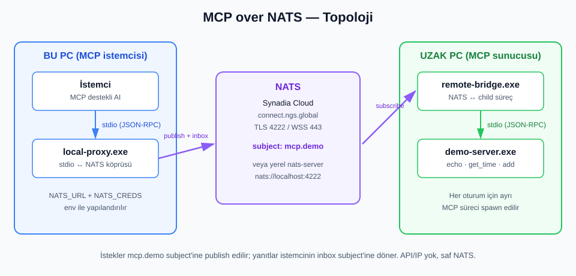
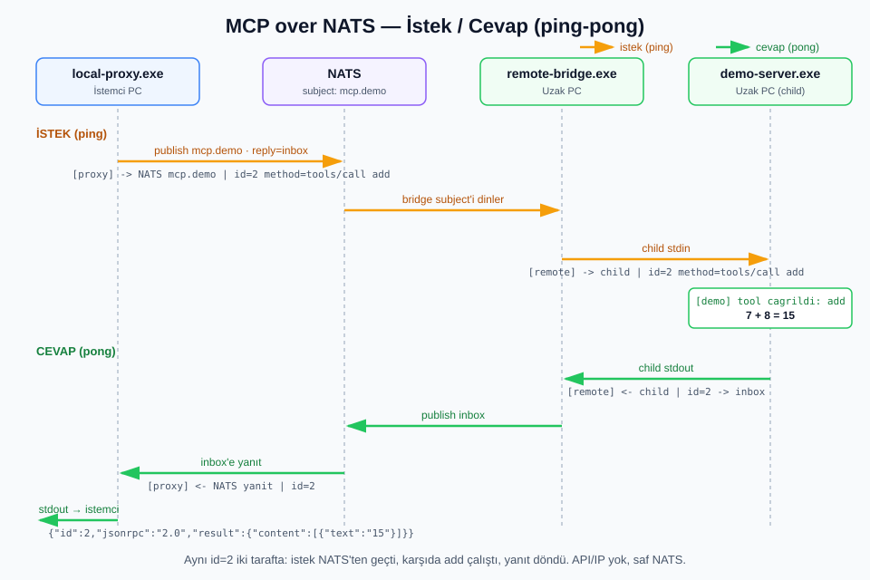
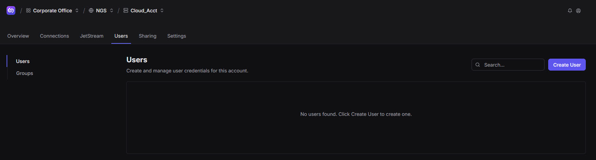
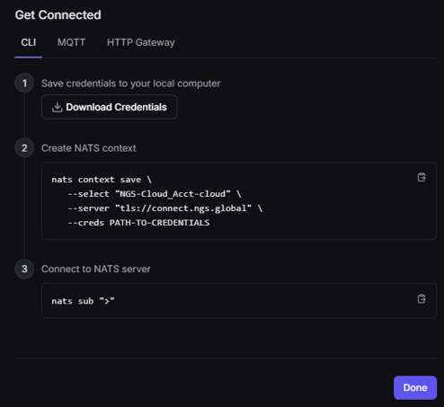
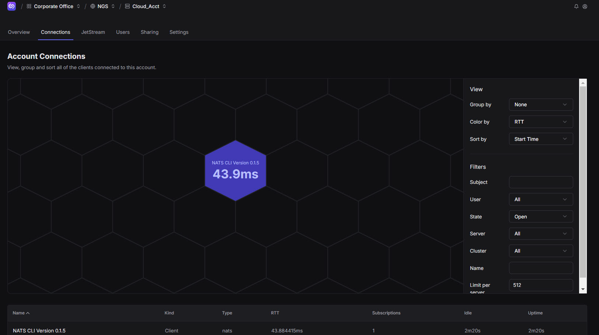

# McpOverNatsSample

<a href="README.md"> English</a> &nbsp;·&nbsp; <a href="README.tr.md"> <strong>Türkçe</strong></a>

Bir MCP destekli istemciyi uzak bir PC'deki MCP sunucusuna **NATS üzerinden** bağlayan en temel örnek kurulum. API veya doğrudan IP bağlantısı yok; tüm MCP trafiği (JSON-RPC) NATS subject'leri üzerinden taşınır. NATS olarak yerel `nats-server` veya **Synadia Cloud** kullanılabilir.

Rust ile yazılmıştır (`async-nats` + `tokio`). Üç küçük binary:

- `local-proxy.exe` — **İstemci PC:** stdio ↔ NATS köprüsü. MCP istemcisi bunu bir MCP sunucusu gibi başlatır.
- `remote-bridge.exe` — **Sunucu PC (uzak):** NATS subject'ini dinler, her oturum için bir MCP sunucu süreci spawn eder.
- `demo-server.exe` — **Sunucu PC (uzak):** Örnek MCP sunucusu: `echo`, `get_time`, `add`.

Canlı iki-terminal demo (ekran görüntüsüyle akış): [DEMO.tr.md](DEMO.tr.md)

## Topoloji



```
İstemci ──stdio──> local-proxy ──NATS──> remote-bridge ──stdio──> demo-server
   (istemci PC)                 (subject: mcp.demo)              (sunucu PC)
```

## Nasıl çalışır

1. İstemci `local-proxy`'yi stdio ile başlatır ve MCP JSON-RPC satırlarını stdin'e yazar.
2. `local-proxy` her satırı `mcp.demo` subject'ine, kendi inbox'ını reply olarak ekleyip publish eder.
3. `remote-bridge` subject'i dinler; reply (inbox) başına bir `demo-server` child süreci spawn eder ve satırı child'ın stdin'ine yazar.
4. Child'ın stdout satırları inbox subject'ine publish edilir; `local-proxy` bunları stdout'a yazar → istemci yanıtı alır.

Tek bir NATS subject'i + istemci başına bir inbox yeterlidir. İstek/yanıt ve bildirimler (notification) aynı hat üzerinden akar.



## Gereksinimler

- Rust (cargo) — derlemek için. Uzak PC'ye sadece derlenmiş `.exe` kopyalanabilir, Rust gerekmez.
- Yerel demo için Windows x64 NATS Server v2.15.3, `bin/` altında hazırdır. [Kaynak ve doğrulanmış dosya özetleri](bin/README.md). Linux/macOS için aynı resmi sürümün uygun paketini kullanın.
- Synadia Cloud için: bir hesap ve `.creds` dosyası (aşağıya bakın).

## Derleme

```bash
cargo build --locked --release
# binary'ler: target/release/{local-proxy,remote-bridge,demo-server}.exe
```

Üç çalıştırılabilir dosyanın kaynakları `src/bin/` altındadır. Linux/macOS'ta
derlenen dosyalar aynı adları `.exe` uzantısı olmadan kullanır.

Taşıma kurgusunu incelemek ve kendi projelerinize uyarlamak için ücretsiz bir
örnektir.

## Ortam değişkenleri

- `NATS_URL` (varsayılan: `nats://localhost:4222`) — NATS adresi. Synadia: `tls://connect.ngs.global:4222` veya `wss://connect.ngs.global:443`
- `NATS_CREDS` (varsayılan: yok) — `.creds` dosyasının tam yolu. Yerel demo için gerekmez.
- `MCP_SUBJECT` (varsayılan: `mcp.demo`) — Köprünün dinlediği/publish ettiği subject.
- `MCP_SERVER_BIN` (varsayılan: yanındaki `demo-server.exe`) — remote-bridge'in spawn edeceği MCP sunucusu.

---

## MCP istemci yapılandırmaları (iki ayrı kayıt)

İki sunucu aynı anda tanımlı kalabilir çünkü **farklı NATS ağlarına** bağlanırlar (yerel/VM vs Synadia Cloud). Tek-bridge kuralı ağ başına geçerlidir: aynı NATS + aynı subject'te tek `remote-bridge` dinlemeli.

Paylaşılabilir hazır dosya: [`mcp.example.json`](mcp.example.json) (creds yolu placeholder'dır, kendinize göre düzenleyin).

### 1) `nats-demo` — yerel / VM (demo-server)

Bu PC'de `nats-server`, uzak/VM'de `remote-bridge` + `demo-server` çalışır. Secret gerekmez.

```json
{
  "mcpServers": {
    "nats-demo": {
      "command": "<PROJE>/target/release/local-proxy.exe",
      "args": [],
      "env": { "NATS_URL": "nats://localhost:4222", "MCP_SUBJECT": "mcp.demo" }
    }
  }
}
```

### 2) `nats-cloud` — Synadia Cloud

`NATS_CREDS` gerçek `.creds` dosyasının yolunu gösterir (repoya girmez). Karşı tarafta cloud'a bağlı bir `remote-bridge` çalışmalı.

```json
{
  "mcpServers": {
    "nats-cloud": {
      "command": "<PROJE>/target/release/local-proxy.exe",
      "args": [],
      "env": {
        "NATS_URL": "tls://connect.ngs.global:4222",
        "NATS_CREDS": "C:\\path\\to\\synadia.creds",
        "MCP_SUBJECT": "mcp.demo"
      }
    }
  }
}
```

---

## MCP istemcileri (Qoder, Kiro, Antigravity, Codex, …)

`local-proxy` standart bir **stdio MCP sunucusu**dur; MCP destekleyen her istemciyle çalışır. `<PROJE>` yerine bu deponun yolunu, `<CREDS>` yerine creds dosyası yolunu koy. Çoğu istemci aynı `mcpServers` JSON'unu kullanır; fark sadece dosya konumu ve birkaç biçimdedir.

Ortak stdio yapılandırması (`mcpServers` biçimi):

```json
{
  "mcpServers": {
    "nats-demo": {
      "command": "<PROJE>/target/release/local-proxy.exe",
      "args": [],
      "env": { "NATS_URL": "nats://localhost:4222", "MCP_SUBJECT": "mcp.demo" }
    }
  }
}
```

- **Qoder** — Ayarlar > MCP (user) veya proje · biçim: `mcpServers`
- **Kiro** — workspace `.kiro/settings/mcp.json` · user `~/.kiro/settings/mcp.json` · biçim: `mcpServers`
- **Antigravity** — `~/.gemini/config/mcp_config.json` (IDE + CLI ortak) · biçim: `mcpServers`
- **Claude Desktop** — Win `%APPDATA%\Claude\claude_desktop_config.json` · mac `~/Library/Application Support/Claude/claude_desktop_config.json` · biçim: `mcpServers`
- **Claude Code** — proje `.mcp.json` · `claude mcp add` · biçim: `mcpServers`
- **Cursor** — proje `.cursor/mcp.json` · user `~/.cursor/mcp.json` · biçim: `mcpServers`
- **Windsurf** — `~/.codeium/windsurf/mcp_config.json` · biçim: `mcpServers`
- **Cline** — VS Code `cline_mcp_settings.json` · biçim: `mcpServers`
- **Gemini CLI** — `~/.gemini/settings.json` · biçim: `mcpServers`
- **VS Code (Copilot)** — proje `.vscode/mcp.json` · biçim: `servers` + `type:"stdio"`
- **Codex CLI** — `~/.codex/config.toml` · biçim: TOML `[mcp_servers.*]`

VS Code biçimi:

```json
{
  "servers": {
    "nats-demo": {
      "type": "stdio",
      "command": "<PROJE>/target/release/local-proxy.exe",
      "args": [],
      "env": { "NATS_URL": "nats://localhost:4222", "MCP_SUBJECT": "mcp.demo" }
    }
  }
}
```

Codex CLI biçimi (TOML):

```toml
[mcp_servers.nats-demo]
command = "<PROJE>/target/release/local-proxy.exe"
args = []

[mcp_servers.nats-demo.env]
NATS_URL = "nats://localhost:4222"
MCP_SUBJECT = "mcp.demo"
```

Cloud için `env`'e `NATS_URL="tls://connect.ngs.global:4222"` + `NATS_CREDS="<CREDS>/synadia.creds"` ekle (yukarıdaki iki-kayıt bölümüne bakın).

---

## Senaryo A — Yerel demo (secret gerekmez)

```bash
# 1) NATS sunucusu
bin/nats-server-v2.15.3-windows-amd64/nats-server.exe -a 127.0.0.1 -p 4222

# 2) Köprü (ayrı terminal)
target/release/remote-bridge.exe
```

İstemci MCP ayarı (stdio):

```json
{
  "mcpServers": {
    "nats-demo": {
      "command": "<PROJE>/target/release/local-proxy.exe",
      "args": [],
      "env": { "NATS_URL": "nats://localhost:4222", "MCP_SUBJECT": "mcp.demo" }
    }
  }
}
```

## Senaryo B — Synadia Cloud

### 1) Credentials indir

Synadia Cloud UI'da hesabının **Users** sekmesinde bir kullanıcı oluştur (varsa seç):



Kullanıcıda **Get Connected** penceresini aç. **CLI** sekmesinde:
1. **Download Credentials** ile `.creds` dosyasını indir.
2. Sunucu adresi `tls://connect.ngs.global` olarak görünür.



> **Not:** Aynı penceredeki **HTTP Gateway** sekmesi REST API için *Bearer token* üretir. Bu token NATS istemci bağlantısında **kullanılamaz**. NATS için gereken, CLI sekmesindeki `.creds` dosyasıdır (JWT + nkey seed).

### 2) Dosyayı proje dışında sakla

Gerçek `.creds` dosyasını repoya **koyma**. Örn. `secrets/synadia.creds` (gitignore'lı) veya proje dışında bir yol. Biçim için [`synadia.creds.sample`](synadia.creds.sample) dosyasına bakın.

### 3) Köprüyü cloud'a bağla

```bash
NATS_URL="tls://connect.ngs.global:4222" \
NATS_CREDS="C:\\yol\\synadia.creds" \
target/release/remote-bridge.exe
```

İstemci MCP ayarı:

```json
{
  "mcpServers": {
    "nats-demo": {
      "command": "<PROJE>/target/release/local-proxy.exe",
      "args": [],
      "env": {
        "NATS_URL": "tls://connect.ngs.global:4222",
        "NATS_CREDS": "C:\\yol\\synadia.creds",
        "MCP_SUBJECT": "mcp.demo"
      }
    }
  }
}
```

Bağlantıyı Synadia UI **Connections** sekmesinden canlı izleyebilirsin:



## Senaryo C — Uzak PC

Uzak PC'ye sadece iki dosya kopyala: `remote-bridge.exe` + `demo-server.exe` (aynı klasörde). Rust gerekmez.

```powershell
$env:NATS_URL="tls://connect.ngs.global:4222"
$env:NATS_CREDS="C:\yol\synadia.creds"
.\remote-bridge.exe
```

İstemci PC'deki MCP ayarı Senaryo B ile aynı kalır. Artık tool'lar **uzak PC'de** çalışır (`get_time` uzak PC'nin saatini döndürür).

> **Önemli:** Aynı `MCP_SUBJECT`'ini aynı NATS üzerinde **tek bir** `remote-bridge` dinlemeli. İki bridge aynı subject'i dinlerse her isteğe iki yanıt döner. Uzak PC'yi devreye alınca bu PC'deki cloud bridge'ini durdur.

---

## Doğrulama

`local-proxy`'ye elle JSON-RPC vererek zinciri test et:

```bash
(printf '%s\n' \
 '{"jsonrpc":"2.0","id":1,"method":"initialize","params":{"protocolVersion":"2025-06-18","capabilities":{},"clientInfo":{"name":"test","version":"0.1.0"}}}' \
 '{"jsonrpc":"2.0","id":2,"method":"tools/call","params":{"name":"add","arguments":{"a":7,"b":8}}}'; sleep 2) \
 | target/release/local-proxy.exe
```

Beklenen: `initialize` yanıtı ve `add` için `"text":"15"`. Synadia için aynı komuta `NATS_URL`/`NATS_CREDS` env'lerini ekle.

## Güvenlik

- Gerçek `.creds` repoya girmez: `.gitignore`, `*.creds`, `/secrets/`, `/target/` ve yerel oturum dökümlerini dışarıda tutar. Birlikte verilen broker'da kimlik bilgisi veya yerel yapılandırma yoktur.
- Repoda yalnızca placeholder'lı [`synadia.creds.sample`](synadia.creds.sample) bulunur.
- `.creds` dosyası JWT + nkey seed içerir; parola gibi davran, paylaşma.

- Yerel komut yalnızca loopback adresini dinler. LAN demosunda broker'ın LAN adresini açıkça seçin; başka bir PC'yi bağlamadan önce kimlik doğrulama, subject izinleri ve güvenlik duvarı erişimini yapılandırın.

## Örneğin sınırları

Bu örnek, istemci inbox'ı başına bir MCP alt sürecini köprü durana kadar tutar;
boştaki oturumları otomatik temizlemez. Yanıtları beklerken proxy'nin stdin'ini
açık tutun. NATS Core, bağlantısı kopuk istemciler için trafiği saklamaz.
Bunlar bu küçük örneğin sınırlarıdır.

## Sorun giderme

- **Uzak PC bağlanamıyor (LAN):** Windows Firewall 4222 gelen bağlantısını engelliyor olabilir.
- **Synadia `authorization violation`:** creds kullanıcısının subject izinleri `mcp.demo`'yu kapsamıyor; Synadia UI'dan izinleri genişlet veya `MCP_SUBJECT`'i izinli bir subject yap.
- **`Erişim engellendi (os error 5)` derlemede:** çalışan `.exe` üzerine yazılamıyor; önce ilgili bridge sürecini durdur, sonra `cargo build`.
- **Yanıt yok:** bridge'in çalıştığından ve doğru `NATS_URL`/`MCP_SUBJECT`'i kullandığından emin ol; bridge stderr'inde `session başladı` satırını gör.

## Sorumluluk reddi

Bu depo, MCP-over-NATS'ı öğrenmek için **olduğu gibi, hiçbir garanti verilmeden** sunulan en temel örnektir; üretim kullanımı için sertleştirilmemiştir.

Bağlantı bilgilerini, subject adlarını ve özellikle `.creds` dosyalarını paylaşmak **tehlikeli olabilir**: bunları ele geçiren herkes broker'ınızda publish/subscribe yapabilir ve köprünün spawn ettiği MCP sunucusuna erişebilir. Kimlik bilgilerini gizli tutun, NATS subject izinlerini dar tutun, broker'ı veya köprüyü herkese açık internete açmayın ve demoyu yalnızca güvendiğiniz ağlarda çalıştırın.

Bu örneği **kendi riskinizle** kullanırsınız; yazarlar bundan doğacak herhangi bir zarar, veri kaybı veya güvenlik olayından sorumlu tutulamaz.

## Kaynaklar

- NATS (resmî): [nats.io](https://nats.io) · sunucu kaynağı: [github.com/nats-io/nats-server](https://github.com/nats-io/nats-server)
- Synadia Cloud: [cloud.synadia.com](https://cloud.synadia.com) · doküman: [docs.synadia.com](https://docs.synadia.com)

## İlgili çalışmalar

- [ExtViaNats](https://github.com/cihadkocasahan/ext-via-nats) — NATS/MCP taşıma yaklaşımını Chrome eklentisine uygulayan başka bir örnek.
- [Diğer projeler ve teknik profil](https://github.com/cihadkocasahan)
